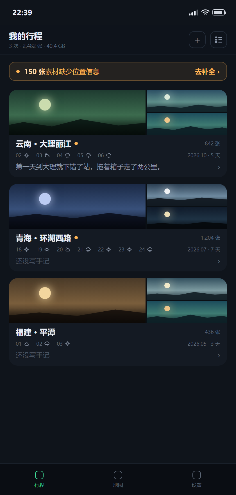

# 旅迹 · TripNest

把手机里的几千张旅行照片，按时间与地点自动归组成一次次行程，在地图上看见走过的地方。

纯本地运行：没有账号、没有后端、没有同步。照片与数据库都留在设备上。



## 功能

- 相册扫描与导入：MediaStore 优先，原生 EXIF 兜底，再退到原始文件名时间
- 行程自动归组：按时间间隔与地理位置聚合，支持手动合并、拆分、改名
- 足迹地图：世界 / 中国两级，按国家与省份点亮；单次行程可看照片点位
- 全屏时间轴：按天分组，支持快速跳转
- 天气回填：按天取历史天气（Open-Meteo archive API），不显示预报
- 备份与恢复、分享、图片压缩、备注与手记

## 快速开始

环境：Flutter 3.47.x、Android SDK、JDK 17。

```bash
flutter pub get
flutter run
```

没有腾讯地图 Key 也能启动，地图页会提示未配置，地名回退到本地地名表。

构建安装包：

```bash
flutter build apk --release
# 产物：build/app/outputs/flutter-apk/app-release.apk
```

## 需要你填的配置

| 配置 | 位置 | 必填 | 说明 |
|---|---|---|---|
| 腾讯地图 Key | 根目录 `.env` 的 `TMAP_KEY` | 否 | 复制 `.env.example` 为 `.env` 后填入；也可用 `--dart-define=TMAP_KEY=...` |
| Flutter SDK | 本机 | 是 | 3.47.x，`flutter doctor` 通过 |
| Android SDK | 本机 | 是 | 设置 `ANDROID_HOME` 或在 `android/local.properties` 写 `sdk.dir` |
| 发布签名 | `android/app/build.gradle.kts` | 发布时 | 当前 release 复用 debug 签名，只适合自用；正式分发前配置自己的 keystore |

Windows 下配置 Key 并启动：

```bat
copy .env.example .env
notepad .env
run.bat
```

`run.bat` 会读取 `.env` 并转成 `--dart-define`，Key 不会被打进仓库。

## 目录

```
lib/
  core/        坐标转换、国家多边形、EXIF、配置
  data/        SQLite、仓库层、天气、地理编码
  features/    行程列表 / 地图 / 时间轴 / 设置
  widgets/     公共组件
assets/        世界与中国地图数据、底图
android/ ios/  平台工程
doc/ docs/     需求、技术方案、页面规格、截图
test/          Dart 测试（示例照片缺失时自动跳过）
```

## 数据流

```
系统相册 --MediaStore/EXIF--> 导入器 --> SQLite（GCJ-02）
                                      |--> 地图渲染（腾讯地图）
                                      |--> 地名解析（腾讯位置服务，需 Key）
                                      |--> 天气（Open-Meteo，坐标转 WGS-84）
```

数据库只存 GCJ-02。国家多边形与 Open-Meteo 需要 WGS-84，转换集中在 `lib/core/coord_transform.dart`，不要在业务层临时换算。

## 测试

```bash
flutter test
```

`test/exif_reader_test.dart` 需要两张示例照片，默认读 `test/fixtures/sample.jpg` 与 `sample.heic`，也可以用环境变量指定：

```bash
LUJI_TEST_JPG=/path/to/a.jpg LUJI_TEST_HEIC=/path/to/a.heic flutter test
```

文件不存在时该用例跳过，不会让整套测试变红。

## 隐私

- 照片只在本机读取与压缩，不上传。
- 地名解析与地图瓦片会请求腾讯位置服务；天气会向 Open-Meteo 发送坐标与日期区间。两者都不带照片、账号或设备标识。
- 仓库不含地图 Key、签名文件与本机路径。

## 常见问题

**地图空白 / 提示未配置 Key**
没有填 `TMAP_KEY`。填进 `.env` 后用 `run.bat` 启动，或直接传 `--dart-define`。

**clone 后 `flutter pub get` 报找不到 `.env`**
本仓库已不再把 `.env` 声明为 asset，正常不会报。若你手动改过 `pubspec.yaml`，把 `- .env` 删掉。

**导入后时间不对**
先看照片是否有 EXIF；没有时按文件名解析。仍不对就在行程里手动调整日期。

## 文档

- [需求规格说明书](需求规格说明书-v0.1.md)
- [技术方案](doc/技术方案-V1.md)
- [页面规格：行程列表](doc/页面规格-行程列表.md)
- [页面规格：行程地图](doc/页面规格-行程地图.md)
- [环境搭建参考](docs/环境搭建参考.md)

## License

本仓库公开用于展示与学习，代码与素材版权归作者所有；未授予再分发或商业使用许可。
